# 发票账本 · 系统操作说明书

版本：v0.5.4 / 适用：本机单账套、服务器私有化单账套、SaaS 多账套 / 更新：2026-11-25

本说明书是随系统发布的操作资料。学校或单位的财务规定可能变化，系统内置的材料清单只作提醒，最终以所在单位现行规定为准。涉及真实数据的导入、覆盖、卸载或恢复前，先下载一份完整备份并检查备份文件可读。

## 1. 系统用途与角色

发票账本把一次支出、相关发票和订单/支付/交通/住宿凭证、报销进度以及外发批次放在同一条记录中。主要页面为“收集”“清单”“批次”“统计”“设置”；SaaS 平台管理员还可进入“平台”。

普通用户可以上传和归属凭证、维护自己的报销记录、创建批次及下载资料包、查看统计、新建经费项目和修改自己的密码。账套管理员还能修改分类与凭证规则、管理成员、处理备份搬迁与诊断。平台管理员管理 SaaS 账套、套餐、邀请码、成员和平台备份。普通用户能查看系统设置，但不能改动管理员专属项目。

## 2. 首次进入与每日工作流程

本机或私有化单账套首次打开网页时，为 admin 设置初始密码；SaaS 主域名首次进入时设置平台管理员。管理员完成初始设置后，再在“设置 → 用户管理”添加其他人。若使用邀请码加入账套，按登录页提示填写邀请码和账号资料。

建议按以下顺序处理一笔支出：付款后在清单“记一笔”，填业务日期、金额和商家；收到发票、订单截图、银行交易或行程单后在“收集”拖入；核对系统识别的金额、日期、分类和归属，点击“全部确认”；在清单详情补齐缺少的材料和经费项目；准备报销时加入批次并生成资料包；送交财务后标记外发；到账后登记实际到账记录。已有记录的补充凭证也可拖入收集页，由系统建议挂到原记录。

## 3. 收集、识别与待归属

在“收集”页面把 PDF、XML、OFD 发票，PNG/JPG/WEBP/HEIC 图片，订单、支付凭证和行程单拖到上传区，或点按钮选择文件。页面逐个显示上传和识别进度。OCR 识别截图需要安装可选 OCR 依赖；没有安装时仍可导入原件并人工填写。

系统按订单号、文件名、金额与实际业务日期、商家等证据把文件组成凭证组，并给出“新建记录”“挂到已有记录”“留在待归属”的建议。美元订单与人民币付款可结合日期、平台和卡号末四位匹配；交通票可结合酒店入住/离店日期和地点归入差旅记录。开票日期与业务发生日期分开保存；只有开票日期时，不把它冒充实际业务日期自动强关联。候选不唯一时，应由人确认。

确认表可修改文件类型、组别、日期、商家、金额、币种、分类与是否免发票。发现文件混组时用“移到其他组”或“拆为单独一组”；发现重复材料时按提示跳过。确认前检查购买方、地点和订单号。点击“全部确认”后再到清单详情检查附件和时间线。

待归属区保存已收到却未能可靠挂到记录的文件。可采纳建议、手工搜索记录并归属、批量生成记录、重新识别，或删除到回收站。已归属但挂错记录的附件，应先在详情里移回待归属，再重新归属。单账套收件箱目录可自动导入：macOS 启动时立即扫描，空闲时每 5 秒扫描一次，文件大小稳定 1 秒后处理；Linux/Windows 还会由文件事件提前唤醒。自动处理失败的文件及说明会留在“无法处理”。SaaS 多账套当前不启用收件箱自动监听。

## 4. 清单与记录详情

“清单”是一笔支出一行的工作台。可按周期、业务日期、开票日期或填报日期、分类、状态、经费项目、市内/市外、平台申请要求和关键词筛选。日期、摘要、分类、金额与状态支持表头排序。默认隐藏已外发和已到账记录，需在状态筛选中主动查看；清单默认每页 10 行，可选 20/30/40/50 或全部，并能输入页码跳转。

列设置支持显示或隐藏列、调整列顺序与拖拽表头边界改变列宽；用户保存后，视图保存在当前浏览器的该用户设置中。宽表上方的横向滚动条与表格同步。点击一行打开详情，可看到名称、单价、数量、总价、发票号、商家、订单/支付/开票/业务/填报日期、附件、凭证清单、经费项目、状态和操作时间线。名称可从订单、发票项目、摘要及商家依次补全；数量仅在明确识别 1 至 100 时使用，否则默认 1；单价按总价除以数量，金额以分存储。人工改正的非空内容不会被自动回填覆盖。

状态通常从“已支出”到“已开票/已收凭证”，再到“凭证齐全”“已外发”“已报销”；也可手工作废并填写原因。凭证清单会说明“必需”“建议”“已有”“不需要”与缺少内容。把补充文件拖到详情或再次通过收集导入。分类错误可在详情改正；若分类词表调整，管理员可在“设置 → 分类整理”批量检查旧记录。

## 5. 批次、资料包与打印

在“批次”新建一次外送批次，选经费项目并从清单添加记录。已作废或已属于其他批次的记录不能直接加入。批次列表和批次内记录也支持每页 10/20/30/40/50/全部及跳页。批次详情可检查总金额、记录、凭证缺口和导出历史。

“生成资料包”提供整本打印 PDF、按分类生成多个 PDF、按清单项目名称合并的 PDF，以及汇总表和原件目录。材料默认先按分类配置顺序，再按业务发生日期排序；汇总表有分类小计、金额和清单/材料数量，并包含名称、单价、数量、总价与发票号。按项目名称打印时，同名项目的附件合为一份 PDF。启用双面打印时，可在订单/记录之间补空白页，使下一单从新纸正面开始。生成后下载 ZIP，先抽查排序、附件齐全性及打印页码。

送交后在批次点“标记已外发”，填写日期、接收人与预约单号。钱到账后选择实际到账的记录登记到账；部分到账可只勾选相应记录。需修改已外发批次时先按页面流程重新打开，并核对财务侧是否已经收件。

## 6. 统计与导出

统计默认按支付日期归属月份；缺少支付日期时回退业务发生日期。也可切换订单、业务、开票、填报、外发或到账日期。页面会说明所选时间口径，切换前先确认统计问题究竟是“买了”“付了”“开票”还是“到账”。

顶部显示本期支出、待处理、在途、已报销，作废金额单列。交叉统计可选分类、项目、商家、月份、市内市外、批次、平台申请等行维度，并选状态、分类、月份、批次等列维度。点击指标、分组、单元格或小计可穿透到对应清单筛选结果。导出 Excel 包含交叉汇总和明细；导出前检查周期、日期口径、筛选条件与分类小计。

## 7. 设置页：用户与账套管理员

“基本”配置购方抬头、税号、超期提醒天数、本地地区和已带明细平台；购方不一致会提示复核，市内/市外判断依据本地地区。“分类”维护名称、颜色、关键词、办理路径及是否需要设备与实验室管理平台申请；办公用品与材料/易耗品/低值品/设备应按实际采购性质区分。“经费项目”维护经费号、名称与负责人；“凭证清单规则”设置分类或通用规则、必需/建议、金额和场景条件与提示文字。

“分类整理”按当前规则重算旧记录，先看建议再批量确认。“用户管理”可添加、调整角色、停用/启用、重置密码或删除成员；不能删除自己或最后一个可用管理员，停用与重置密码会让该用户已有设备退出。“登录与安全”供每个人修改自己的密码。“备份与搬迁”用于完整包备份、导入预览、合并或覆盖；覆盖需要二次确认，先保存当前备份。“运行日志与诊断”生成脱敏诊断包；没有显式配置上传目标时仅留本机。“关于系统”展示当前安装版本、部署形态与本 PDF 的在线预览/下载。

## 8. SaaS 平台管理员操作

仅在多账套部署显示“平台”。平台管理员在主域名登录，创建账套、指定管理员、配置套餐与到期日、维护成员和邀请码；账号可属于多个账套，登录后切换。平台可查看使用量、账套状态与授权记录，并导出账套数据包。成员数、存储和当月新增记录数达到套餐上限时，新建动作会被拦截；已有数据仍可查看、导出和备份。停用、关闭或订阅到期的账套转只读，恢复套餐或状态后再检查写入。配置 SMTP 后可使用通知邮件；邮件地址和凭据按设置页要求保存，不在说明书或诊断包中明文记录。

## 9. 本机安装与启动

macOS/Linux 需 Python 3.12；本地编译前端还需 Node.js 20+。获取仓库后，在根目录执行 scripts/setup.sh，再运行 backend/.venv/bin/invoice-sorting。默认打开 http://127.0.0.1:8765，只监听本机；数据默认在 ~/InvoiceSorting。用 INVOICE_SORTING_DATA_DIR 改数据目录，INVOICE_SORTING_AUTH_ENABLED=false 可关闭个人本机登录。Windows 10 1803+/11 使用 scripts\setup.cmd，启动 backend\.venv\Scripts\invoice-sorting.exe；需预装 uv。安装选项 NO_OCR=1 可先跳过 OCR，后续重新安装依赖并重启。下载依赖前请测官方源和可用镜像，以实际速度选用，不把镜像永久写成生产默认。

## 10. Ubuntu 服务器与 Docker 部署

Ubuntu 22.04/24.04 可运行仓库 deploy/install.sh。一键安装默认私有化单账套，设置 DEPLOY_MODE=saas 为多账套；可配置 DOMAIN、ENABLE_HTTPS、EMAIL、HTTP_PORT、APP_PORT、INSTALL_DIR 与 DATA_DIR。安装脚本默认 release 通道，下载固定版本的 GitHub Release 包，逐项验证 SHA-256。安装后立即打开网页设置首个管理员密码，公网部署先确认域名、反向代理与 HTTPS。Docker Compose 从 deploy/docker 目录执行 docker compose up -d --build；配置持久卷保存 /data。端口是否对外开放应以实际监听和 Docker 映射为准。

服务器默认程序目录 /opt/invoice-sorting，数据目录 /var/lib/invoice-sorting，systemd 服务名 invoice-sorting，Nginx 站点为 /etc/nginx/sites-available/invoice-sorting 及其 enabled 链接。常用检查：systemctl status invoice-sorting；journalctl -u invoice-sorting -f；访问 /api/health。部署配置与全部变量、HTTPS、泛域名、Docker 细节见仓库 docs/部署与运维.md；修改凭据时使用安全的环境或配置存储，不把秘密写入截图、工单和仓库。

## 11. 备份、升级、回滚与搬迁

“设置 → 备份与搬迁 → 立即备份”可下载完整账本包并在服务器保留最近 10 份。单账套备份含账号密码哈希但不含明文密码，应按敏感文件保管；SaaS 账套备份不含平台共用账号。迁移到其他机器/账套时先导出，在目标端预览；“合并”按附件与发票信息去重并保留已有记录，“覆盖”整体替换前自动备份且要求确认。跨机器也可以在停服务后复制完整数据目录，恢复后核对文件属主、权限、记录数和附件可打开。

Ubuntu 上重新运行安装脚本即可升级，脚本先备份数据库、校验发布物并健康检查。指定 VERSION=v0.5.4 可固定版本；指定旧版为回滚。回滚前应同时确认旧版是否能读取新数据结构，并保留升级前的数据库备份。Docker 升级应先备份 /data，再拉取/重建镜像并验证健康检查。本机升级可拉取对应版本代码并重新运行 setup 脚本。当前系统版本以“设置 → 关于系统”和服务器 VERSION 文件为准。

## 12. 卸载与数据保留

卸载前：下载完整备份，确认备份可解压且数据库/附件在包内；记下实际 DATA_DIR、INSTALL_DIR、域名和反向代理配置。停止服务后先做一次独立目录的备份。以下操作区分“停止程序”“删除程序”和“删除数据”，最后一步不可从程序文件恢复。

本机自用：停止运行中的 invoice-sorting 进程，移走仓库及其 backend/.venv 即移除程序；默认 ~/InvoiceSorting 或自定义 INVOICE_SORTING_DATA_DIR 仍保存数据。确认备份和迁移完成后，才由管理员单独删除数据目录。

Ubuntu 一键部署：执行 systemctl disable --now invoice-sorting，移除 /etc/systemd/system/invoice-sorting.service 后执行 systemctl daemon-reload；核对 Nginx 站点内容与归属，再移除 /etc/nginx/sites-enabled/invoice-sorting 和 /etc/nginx/sites-available/invoice-sorting，并用 nginx -t 验证后重载 Nginx。程序目录 /opt/invoice-sorting 可在备份后移走；/var/lib/invoice-sorting 是数据目录，必须另行确认并单独处理。不要因为本应用卸载就卸载共享的 Nginx、Python、uv 或系统用户；其他服务可能仍依赖它们。自定义目录按实际配置替换。

Docker：在 deploy/docker 目录执行 docker compose down 停止并移除应用容器，命名卷会保留。先导出卷内 /data 与账本备份，再按 Docker 平台的卷管理流程删除对应卷；不要直接使用会误删其他数据卷的全局清理命令。若用了宿主机目录挂载，目录不会随 compose down 删除。Windows：关闭进程并移走仓库/虚拟环境；%USERPROFILE%\InvoiceSorting 或自定义数据目录仍保留。需要彻底删除时先确认备份，再单独删除数据目录。

## 13. 故障排查与支持

上传失败先看文件格式、文件大小和网络；识别错误在确认表或详情人工修正，并保留原件。发票归为“其他”时补分类关键词后使用分类整理。资料包缺件时检查记录是否加入批次、附件是否已归属以及凭证清单是否仍缺必需材料。界面显示只读时检查私有化授权、账套启停和套餐到期状态；只读仍可查看和备份。升级后页面仍旧时刷新浏览器并检查前端静态文件版本与服务版本。服务异常先查看 systemctl 状态和日志，管理员可生成脱敏诊断包；提交问题时提供版本、部署形态、复现步骤和已脱敏日志，不附敏感原件或密码。

系统源文档：仓库 README.md 为快速指南，docs/部署与运维.md 是详细运维资料，docs/api-contract.md 是接口契约。说明书 PDF 从本文件生成，并随对应版本前端发布包一起提供。

以下图解均取自独立、无真实报销资料的演示账本，界面中的商家、金额与批次仅作示例。截图显示的是操作入口和当时的页面状态；实际按钮与字段会随角色、部署形态和记录状态变化。PDF 可在“关于系统”放大查看。

## 14. 用户操作速查：每项功能怎么做

新建支出：打开“清单”，点“记一笔”；选业务发生日期，输入总价、商家和摘要，选择分类与经费项目；保存后打开详情，核对名称、数量与单价。付款日期和发票开票日期应填写在对应字段，不要为了排序而改写业务发生日期。

上传凭证：打开“收集”，把同一笔支出的发票、订单、付款记录和其他附件一起拖入。等待识别结束后逐组核对金额、购方、订单号、日期、地点与文件类型；确认建议要挂到的记录；如果没有可靠匹配，选新建或留在待归属。点击“全部确认”，再到清单检查附件是否齐全。

补充/纠正附件：打开该笔清单详情，拖入缺少的原件，或在收集页继续上传；若系统建议另一笔记录，手工选正确记录。挂错时在详情附件操作里移回待归属，然后重新归属。重新识别会刷新提取结果，已有人工确认的业务内容仍需再次核对。

修改业务信息：在详情分别修改名称、数量、单价、总价、分类、经费项目和各日期。实际业务日期用于差旅与其他凭证的自动关联；发票开票日期只记录开票行为。住宿发票没有住宿时间也能建账，入住/离店先留空，等酒店订单或水单补充；系统会提示待完善。市内/市外按系统所在城市初判，必要时人工纠正。

检查凭证清单：在详情查看分类对应的必需与建议材料，点开缺少项看说明。免发票、网购、外地发票、金额门槛和平台申请条件会影响需要的材料；若已交纸质文件而系统没有电子件，可按实际情况记录，不要凭空标为已上传。分类变更后再次检查清单是否重新计算。

筛选与导出：在清单顶部设置时间范围、日期口径、状态、分类、项目与搜索词；需要查看已外发/已到账时改变默认状态筛选。点击表头排序；用“列设置”保留常用列，拖表头边缘调宽。导出前先确认当前筛选结果数量；统计穿透进入的清单也会带对应筛选条件。

建立批次并打包：进入“批次”点新建，选项目与名称；从可添加清单中勾选记录。核对金额、缺件提示和记录顺序后选择资料包形式、是否双面打印，再点生成。下载 ZIP 并打开汇总表和至少一份打印 PDF 抽查；分类 PDF 与按项目名称 PDF 适合不同的归档和装订需求。

完成报销：交付资料后回到批次填写外发日期、接收人与预约号。到账时勾选真正已到账的记录并登记到账日期和金额；未到账记录继续留在在途状态。若实际到账与预计金额不同，先核查财务记录再登记，保留原始凭证与时间线。

## 15. 账套管理员操作速查

初始化设置：首次进入先设置管理员密码；在“设置 → 基本”填写购方抬头和税号、所在城市、超期提醒天数，保存并检查前端提示。购方信息影响发票核验，城市影响市内/市外判断。若是多人使用，马上在“用户管理”添加至少一位可用管理员并逐个分配角色。

维护分类：在“分类”编辑分类名称、颜色、关键词与办理路径，明确是否需要设备与实验室管理平台申请。修改分类词后，在“分类整理”预览建议，逐条核对再批量提交。商品记忆、税收分类简称、商家记忆与关键词可能共同影响自动归类，综合电商商家尤其要核对商品本身。

维护凭证规则：在“凭证清单规则”先选择通用或某个分类，再选材料种类、必需/建议级别、金额和场景条件，写清提示文字；保存后用一条真实记录验证缺件提示和资料包汇总。调整规则不会修改原始发票文件，但会影响后续清单提示。

管理经费项目与成员：在“经费项目”维护经费号、项目名、负责人；旧记录的项目归属应逐笔检查。用户管理中新增成员后，确认其角色和能否进入正确账套。停用账号或重置密码会使该账号现有会话失效；删除成员前确认已导出必要的审计资料，历史上传人和操作人仍保留显示名称。

维护备份：每次大批量导入、规则调整或升级前，在“备份与搬迁”点“立即备份”并下载包；建议定期在隔离环境演练恢复。导入包先预览记录、附件、项目、设置与账号差异；通常使用合并，只有明确要整体替换时才选择覆盖并完成二次确认。多账套平台控制库备份由平台管理员另行维护。

排查运行故障：先查看“运行日志与诊断”生成的脱敏包和最近错误。诊断包只用于排障，不包含原始发票或明文口令；仍应按内部安全规定传输。如果是授权或套餐导致只读，按页面原因找私有化授权或平台管理员处理，不应直接修改数据库绕过限制。

## 16. 安装与运维命令速查

本机 macOS/Linux：git clone https://github.com/lsgoodlionel/Invoice-sorting.git；cd Invoice-sorting；scripts/setup.sh；backend/.venv/bin/invoice-sorting。Windows PowerShell：git clone 同一仓库；cd Invoice-sorting；scripts\setup.cmd；backend\.venv\Scripts\invoice-sorting.exe。默认地址 http://127.0.0.1:8765；首次配置管理员密码。

Ubuntu 私有化安装：curl -fsSL https://raw.githubusercontent.com/lsgoodlionel/Invoice-sorting/main/deploy/install.sh | sudo bash。SaaS 安装：相同下载命令后接 sudo DEPLOY_MODE=saas bash。公网域名安装可传 DOMAIN=实际域名 ENABLE_HTTPS=true EMAIL=通知邮箱；证书与 DNS 生效后再验证 HTTPS。固定版本安装：在 sudo 后加 VERSION=v0.5.4。安装脚本会下载 Release 附件并核对 SHA256SUMS。

Docker：cd Invoice-sorting/deploy/docker；复制 .env.example 为 .env，设置持久卷与发布端口后执行 docker compose up -d --build。检查：docker compose ps 与 docker compose logs -f app；停止：docker compose down。compose down 不会删除命名卷，数据仍在卷或宿主机挂载目录。

Ubuntu 检查与升级：systemctl status invoice-sorting；journalctl -u invoice-sorting -f；curl http://127.0.0.1:18765/api/health（内部端口可能已自定义）。升级前下载备份，重新运行安装脚本；如需固定版本，传 VERSION=v0.5.4。查看安装记录：cat /opt/invoice-sorting/VERSION。不要在生产服务器上仅凭浏览器缓存判断升级是否完成，应同时核对服务、版本文件和页面“关于系统”。

Ubuntu 停用并卸载程序：systemctl disable --now invoice-sorting；移除本应用的 systemd 单元并执行 systemctl daemon-reload；确认站点文件只服务本应用后移走对应的 Nginx enabled/available 文件，先执行 nginx -t 再重载。最后移走程序目录；数据目录另行保留或由管理员按备份流程处理。此处刻意不提供通配符删除命令，避免误删共享目录和其他站点。

## 17. 业务字段与时间口径速查

名称是清单项目名称，便于搜索和按项目合并 PDF；摘要是该笔支出的简短说明；分类决定凭证清单和部分办理提示；经费项目表示资金归属。数量与单价描述订单/发票项目，合计总价是报销金额的主要依据。发票号用于核对与去重，不能用订单号代替。外币订单同时保留原币金额和人民币支付金额时，应核对两张凭证的币种与汇率背景，避免把币种差异当成两笔支出。

订单日期是下单时间，支付日期是钱实际付出的时间，业务发生日期是服务或出行发生的时间，开票日期是税务发票开具时间，凭证填报日期是向系统提交材料的时间，外发日期是资料送交时间，到账日期是报销款到账时间。统计默认以支付日期分月，缺失时回退业务发生日期；差旅住宿归并优先使用实际出行和入住日期。若发票只写开票日期而未写服务时间，该笔记录可以存在，但实际业务日期应留空或由订单、水单和人工核对后补齐。

交通住宿的“市内/市外”以“设置 → 基本”的所在城市为参考，城市识别与站点名称可能需要人工复核。平台申请标记服务于设备、实验室材料等采购流程筛选，和“是否需要发票”是不同维度。金额小计可能按一组住宿和来往交通累计，检查统计时应先确认当前行是单条凭证还是一笔归并后的报销记录。

## 18. 图解：收集与清单操作

本章按实际操作顺序给出入口、填写、核对与筛选截图。上传确认页会随着文件类型和识别结果动态变化；选择文件后，应按第 3 章逐项核对，不应只凭自动建议提交。示例截图来自空演示账本和人工创建的演示支出。

### 18.1 进入清单并识别操作区

步骤 1：在左侧点“清单”。先看标题下的记录数与合计金额，再看日期口径、起止日期、快捷区间和状态筛选。默认不含已外发、已报销与作废记录。

步骤 2：要查看某个时间段，先选日期口径，再输入日期或点快捷区间。要查隐藏状态，勾选相应状态；筛选后的合计会随之改变。表格为空时，点“去收集页”或“记一笔”。

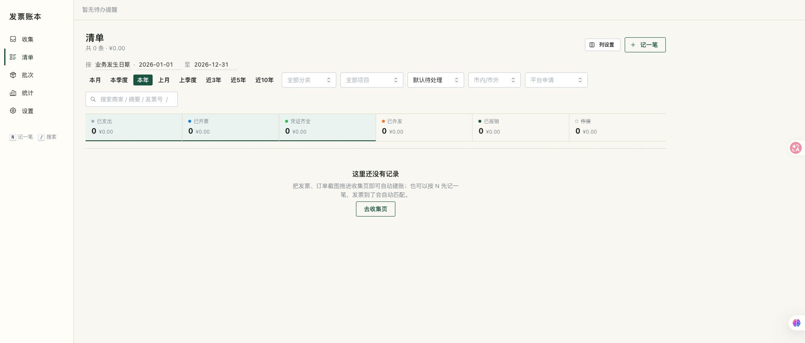

### 18.2 快速记一笔

步骤 1：点击清单右上角“记一笔”，核对“业务发生日期”，填写以元为单位的金额和商家。分类、经费项目可在有把握时选择。

步骤 2：点击“保存为已支出”；保存后立即到清单详情补摘要、项目名称、付款信息和附件。金额是这笔记录的人民币报销金额，外币订单的原币信息另在详情维护。

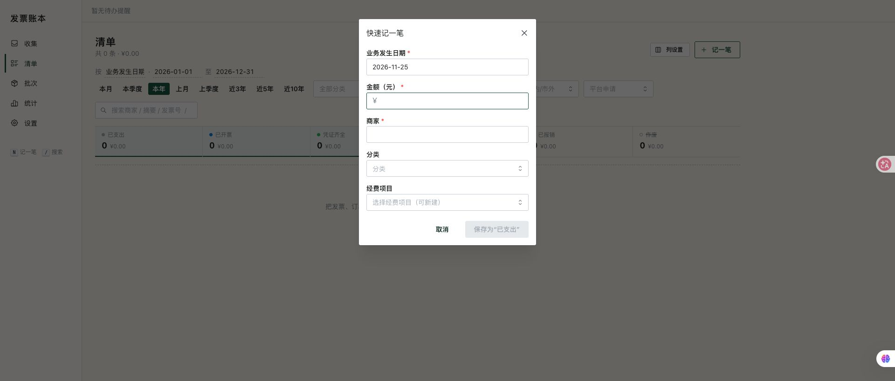

### 18.3 阅读清单行并排序分页

步骤 1：保存后，在清单行核对业务日期、发票开票日期、填报日期、商家、名称、单价、数量、总价、发票号、状态和凭证缺项。横向滚动条可浏览右侧列。

步骤 2：点击有排序图标的表头切换升降序；选择“每页显示”10、20、30、40、50 行或全部，输入页码后点“跳转”。日期口径与表头排序要分别核对。

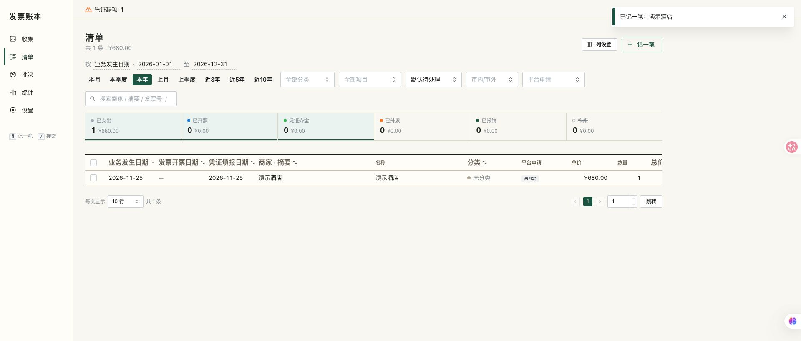

### 18.4 打开详情并核对字段与凭证

步骤 1：点击目标清单行，右侧详情出现。依次核对状态步骤、业务日期、金额、商家、摘要、名称、单价、数量、分类、项目、币种和市内市外。

步骤 2：下滑查看订单号、开票日期、填报日期、凭证清单、附件、操作时间线。改字段后按页面提示保存；上传附件后再次核对缺件状态。缺少实际业务日期时保持空值，待订单或水单补充。

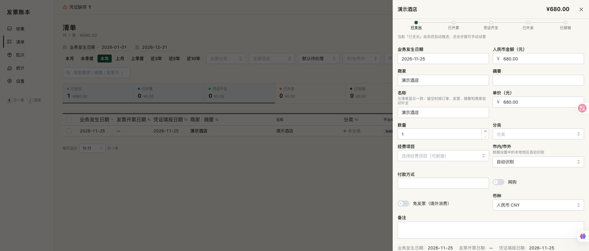

### 18.5 保存自己的清单列视图

步骤 1：点“列设置”，勾选要显示的字段，用每行的上移、下移按钮调整顺序，最后点“保存设置”。

步骤 2：回到表格，在表头右边缘拖动调整列宽。设置保存在当前浏览器的当前用户视图中；换设备或清理浏览器数据后应重新设置。

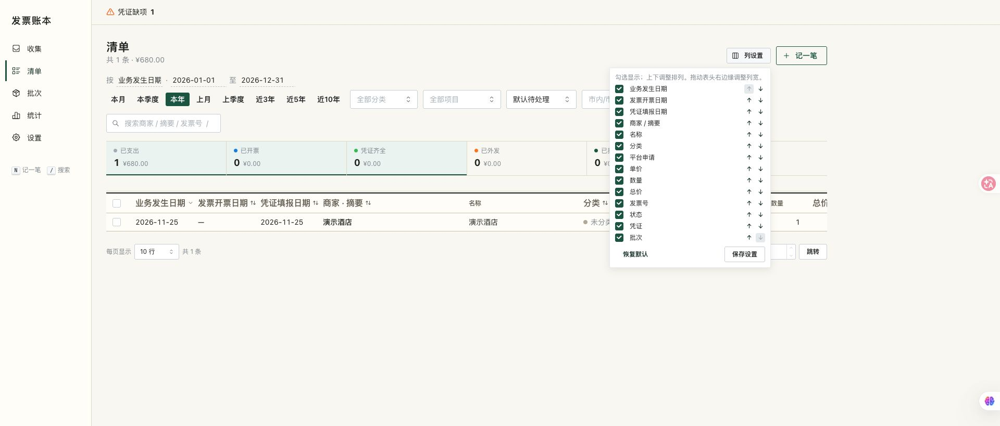

### 18.6 收集发票、订单和支付材料

步骤 1：点左侧“收集”，把文件拖入上传区域，或点击该区域选择 PDF、OFD、XML 或图片。建议同一笔支出的订单、付款、发票与行程材料一起上传。

步骤 2：等待上传和识别进度结束，再逐组查看文件类型、商家、金额、币种、日期和建议归属。若无可靠记录，选新建或留待归属；确认前检查重复文件与混组。图中只展示上传入口；识别确认界面随原件内容变化，详细判断见第 3 章。

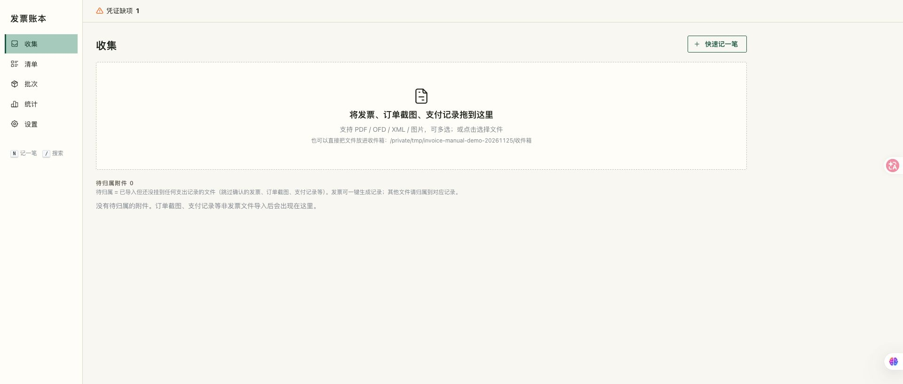

## 19. 图解：批次、资料包与统计

### 19.1 选择批次或新建批次

步骤 1：点“批次”，先用状态和日期筛选确认是否已有目标批次。一个批次代表一次送财务的资料集合。

步骤 2：没有目标批次时点“新建批次”；批次详情会集中显示记录、材料缺项、打包选项和外发状态。

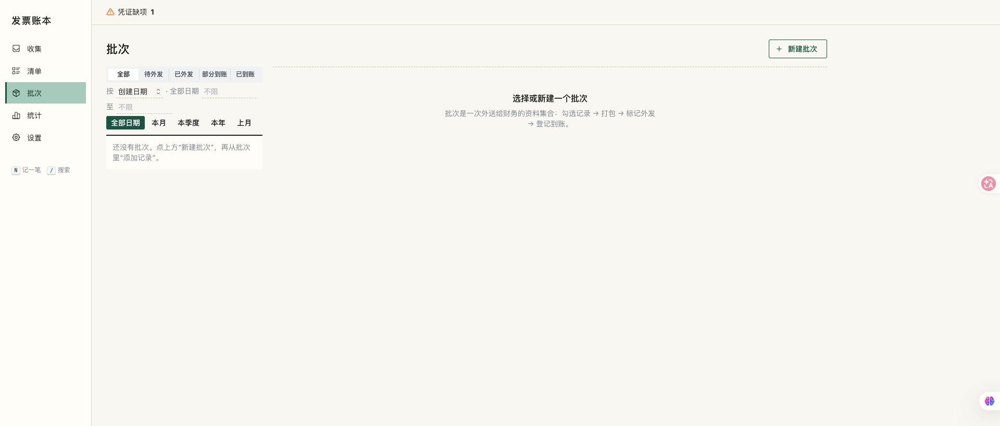

### 19.2 填写批次信息

步骤 1：填写批次名称；如需限定经费来源，选择经费项目，并可写备注。名称建议包含月份、经费项目或报销事项，便于以后检索。

步骤 2：点击“创建”，进入新批次详情。创建后再次核对名称与项目；项目不同的记录不应混入受项目限定的批次。

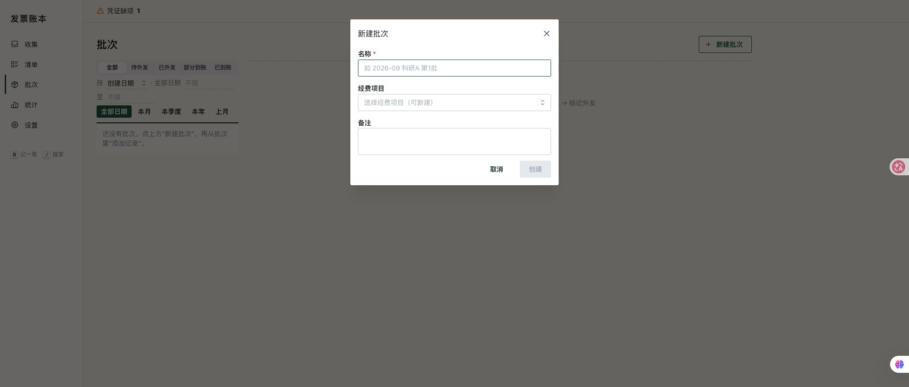

### 19.3 按条件添加记录

步骤 1：在批次详情点“添加记录”，用日期、分类、经费项目、平台申请、状态、凭证和搜索词缩小候选范围。

步骤 2：勾选记录，核对页脚“已选条数”和金额，再点“加入批次”。如果材料缺失，先读提示，回详情补件；确实需要先装入批次时才确认继续。

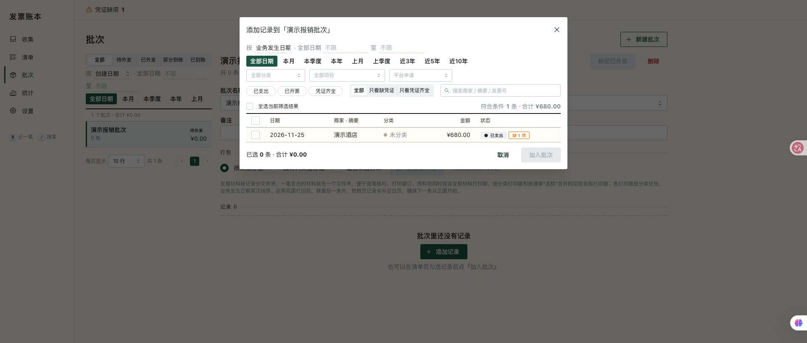

### 19.4 处理必需凭证缺项

步骤 1：系统出现“需要确认”时，阅读缺项的记录编号、商家和金额。点“取消”返回补件，或在业务上允许时点“仍然加入”。

步骤 2：加入不代表材料齐全；批次详情仍会提示缺件。外发之前应逐条核对，必要时在详情标注“不需要”的原因。

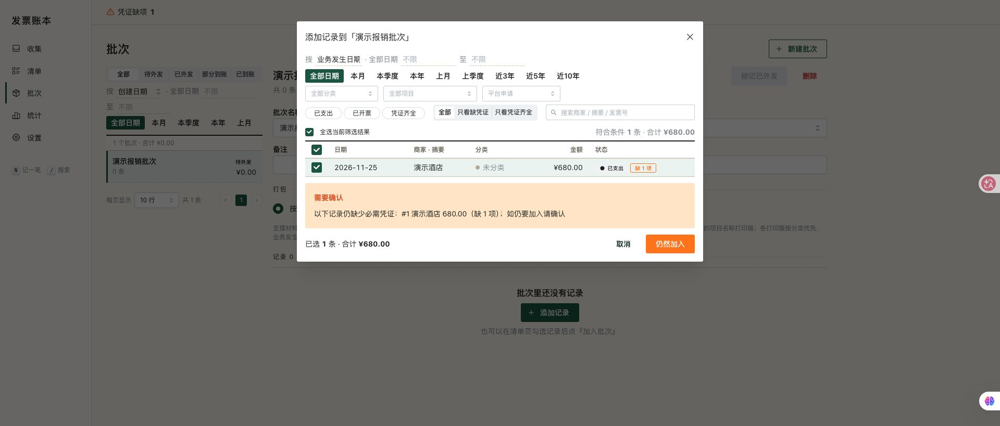

### 19.5 选择打包结构与双面打印

步骤 1：在“打包”区域选择“按支出分组”或“按材料类型分组”。要纸张双面打印时勾“适合双面打印”，再点击“生成资料包”。

步骤 2：下载生成的 ZIP，检查汇总表、整本打印 PDF、分类 PDF、按名称合并的 PDF 和原件目录。材料按分类与业务时间排序；双面模式可能在记录间补空白页，确保下一单从纸张正面开始。

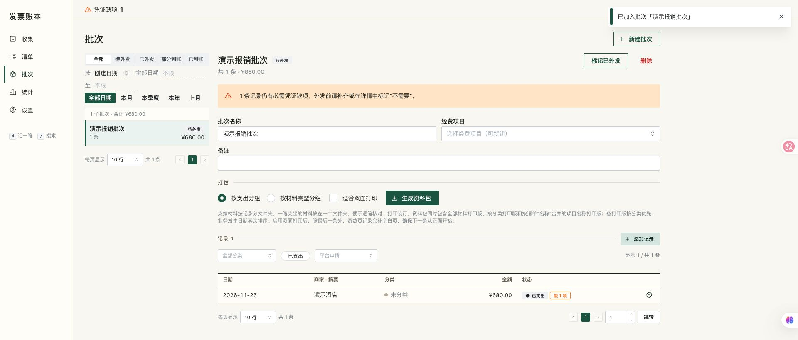

### 19.6 统计交叉分析与穿透

步骤 1：点“统计”，先看顶部所选日期口径。默认支付日期，缺失时回退业务日期；可选其他口径后重看月份与合计。

步骤 2：在“行”和“列”中选择分类、项目、月份、状态等维度；点击有数字的单元格进入对应清单。导出 Excel 前核对区间和口径，避免把支付月份与开票月份混用。

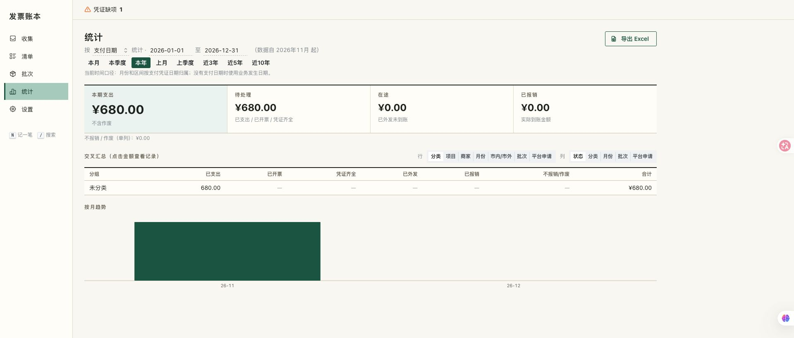

## 20. 图解：账套管理员设置

以下设置截图来自隔离演示账本。正式账本涉及购方、账号和备份的变更须按单位流程操作。普通用户可查看部分设置，但只有管理员可修改受限项目。

### 20.1 基本设置

步骤 1：打开“设置 → 基本”，填写购方抬头和税号，设置超期提醒天数与本地地区；本地地区用于市内市外和外地发票初判。

步骤 2：检查已带明细平台名单，点击“保存设置”。页面下方显示实际数据目录与收件箱位置；本机自动收集还须确认 watcher 已启用。

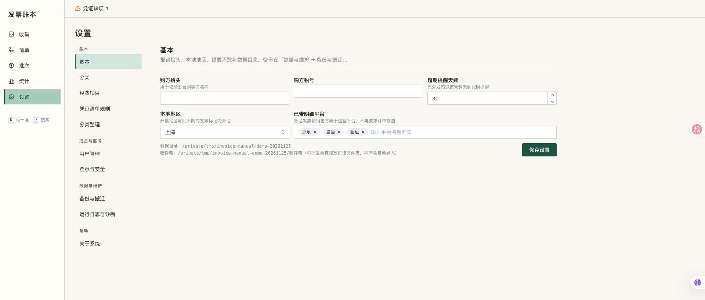

### 20.2 查看分类与平台申请标记

步骤 1：打开“分类”，查看每行的名称、平台申请、关键词与办理路径。办公用品等显示“无需”，材料、易耗品、低值品和设备可显示“需要”。

步骤 2：点对应行“编辑”检查关键词和平台开关；需要新分类时点“新增分类”。调整后用“分类整理”复核历史记录。

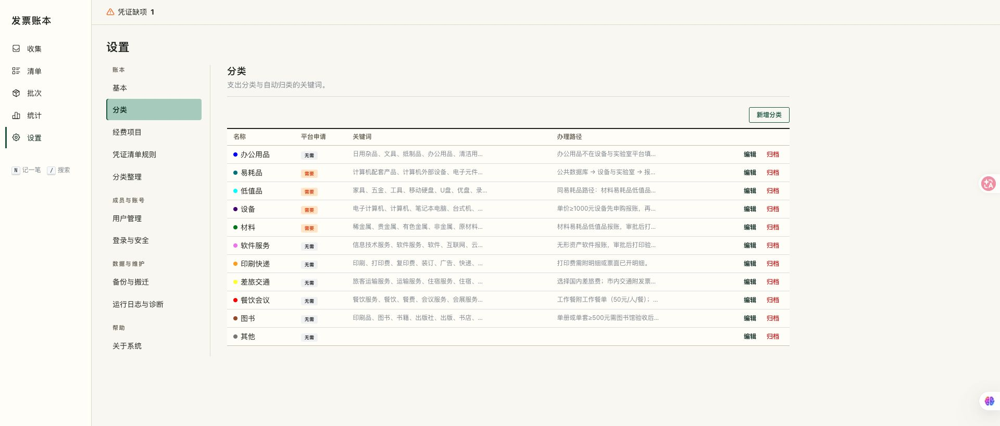

### 20.3 编辑分类关键词与办理路径

步骤 1：在“编辑分类”中核对名称与颜色，在识别关键词输入新词并回车；避免过宽的通用词错误吸收其他类别。

步骤 2：填写办理路径，按学校流程设置“需要在设备与实验室管理平台填写申请”，保存后抽查一条对应清单的分类与凭证清单。

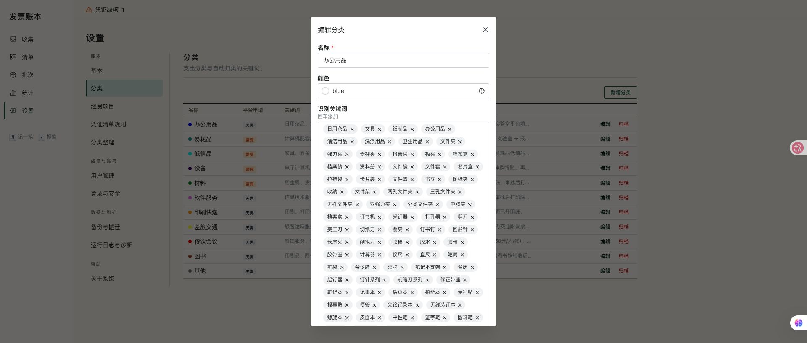

### 20.4 管理经费项目

步骤 1：打开“设置 → 经费项目”，查看现有项目与经费号。记录、批次与统计都可以按此项目归集。

步骤 2：点“新增项目”或现有项目的编辑入口，填写经费号、名称、负责人并保存。修改项目后回到清单抽查归属。

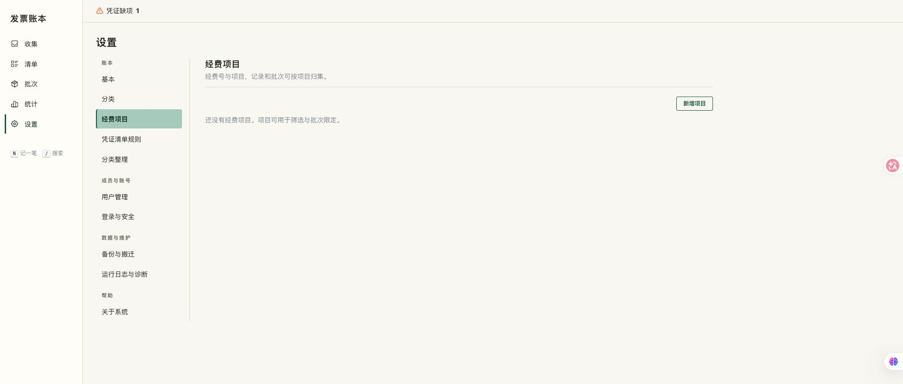

### 20.5 新增经费项目

步骤 1：在弹窗分别填写“经费号”“名称”“负责人”；经费号按单位财务系统实际编号填写。

步骤 2：点“保存”，返回列表确认新增项目。新增项目不会自动把历史支出改归到新项目。

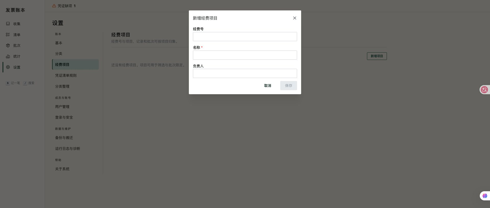

### 20.6 查看凭证清单规则

步骤 1：打开“凭证清单规则”，查看通用规则与分类专用规则，逐行核对附件类型、必需/建议、金额/场景条件和提示文字。

步骤 2：修改前先确定规则适用范围；过宽的条件会使大量历史记录出现缺件提示。规则以单位现行规定为准。

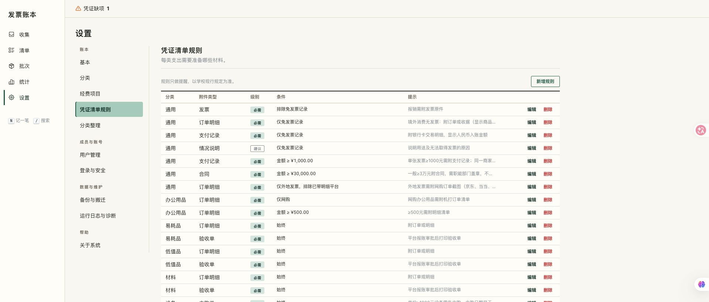

### 20.7 新增或修改凭证规则

步骤 1：点“新增规则”，选择适用分类和附件类型，设为“必需”或“建议”。按需填写金额下限、上限、网购、外地、免发票和发票内容条件。

步骤 2：写清用户能照办的提示文字，保存后打开一条符合条件的支出详情，核对材料清单是否正确出现。

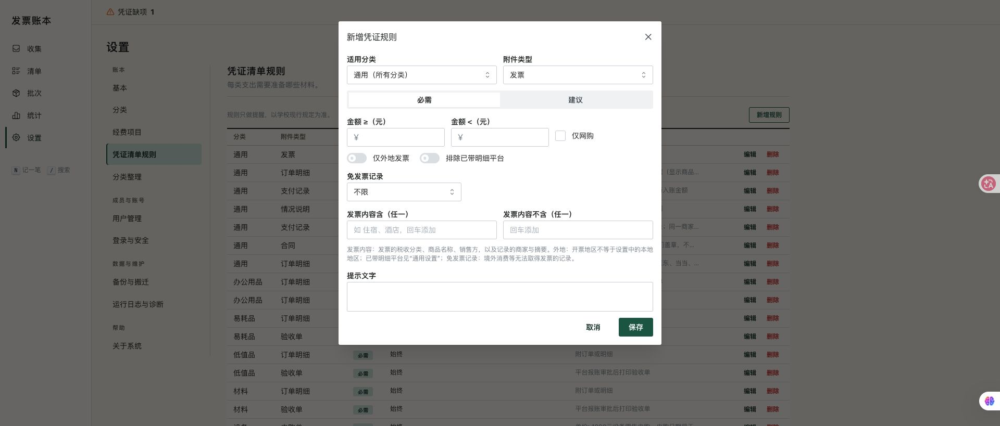

### 20.8 按新规则整理历史分类

步骤 1：打开“分类整理”，先运行/查看当前分类建议，核对原分类、建议分类与依据。

步骤 2：只勾选有充分依据的记录再应用；业务上有争议的记录留给人工逐笔复核。应用后在清单检查分类、平台申请和凭证缺项。

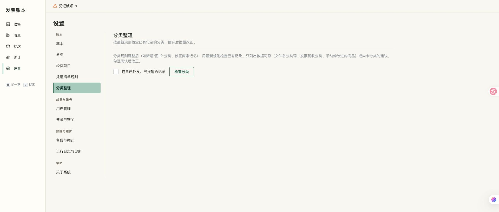

### 20.9 查看用户与账号状态

步骤 1：打开“用户管理”，检查成员用户名、姓名、角色、状态及最近登录。先保证至少有一位可用管理员。

步骤 2：按需用“编辑”“重置密码”“停用”或“删除”。停用和重置会使该成员的现有会话失效；删除前先检查历史操作记录保留需求。

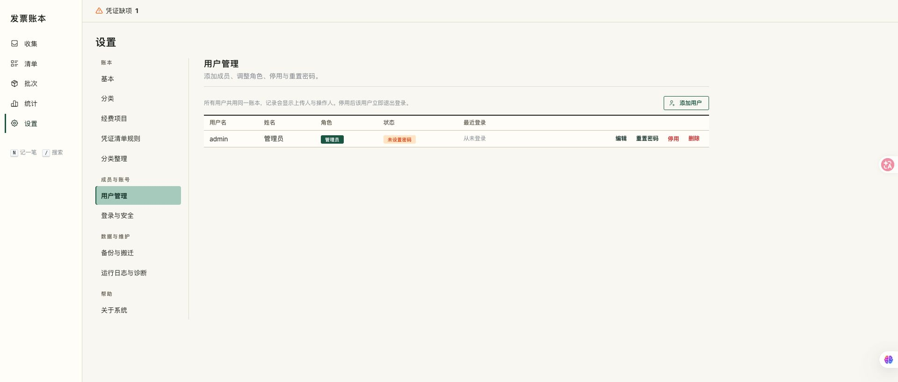

### 20.10 添加成员

步骤 1：点击“添加用户”，填写用户名、显示姓名，选择“普通用户”或“管理员”。角色决定能否管理设置、规则、备份与成员。

步骤 2：设置符合页面要求的初始密码并再次输入确认，点击“创建用户”。仅通过安全渠道交付初始密码，并要求成员首次登录后自行修改。

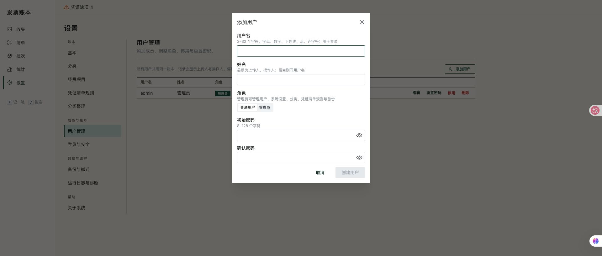

### 20.11 修改自己的登录密码

步骤 1：进入“登录与安全”，先确认当前登录账号，再输入旧密码、新密码和确认密码。

步骤 2：提交后重新登录验证。管理员重置他人密码请在“用户管理”中操作，且不要把密码放入说明书截图或工单。

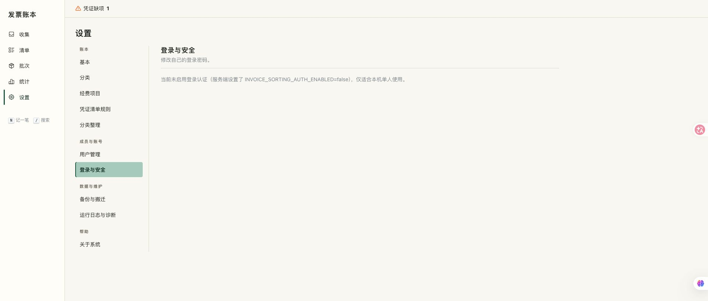

### 20.12 备份、预览与恢复

步骤 1：打开“备份与搬迁”，点“立即备份”，下载完整包并检查能打开。大批量导入、升级或覆盖前先备份。

步骤 2：恢复时先上传备份包并看导入预览，再选合并或覆盖。覆盖会替换目标账本数据，须核对目标环境、记录数与附件后完成二次确认。

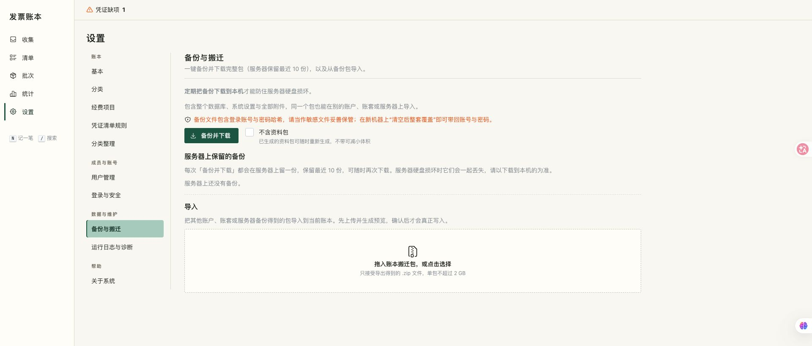

### 20.13 生成脱敏诊断包

步骤 1：打开“运行日志与诊断”，先查看最近运行情况；需要排障时填故障缘由并生成诊断包。

步骤 2：下载后按单位规定保存，报告问题时附版本、复现步骤和脱敏诊断资料。原始发票、口令和完整证书不应附在诊断材料中。

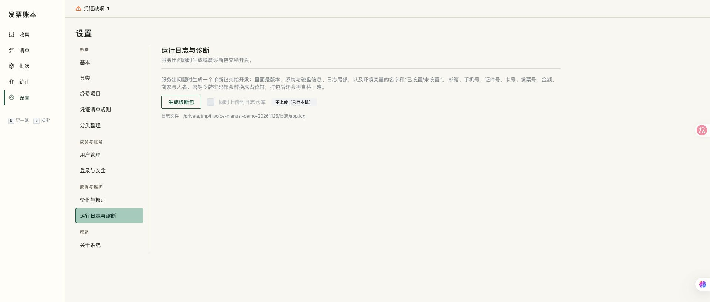

### 20.14 在线预览与下载本说明书

步骤 1：在“设置 → 关于系统”核对当前安装版本和部署形态。下方嵌入本 PDF，可放大浏览各操作截图。

步骤 2：需要离线使用时点“下载 PDF”；预览失效时点“在新窗口打开”。更新程序后重新打开此页，核对版本与 PDF 封面一致。

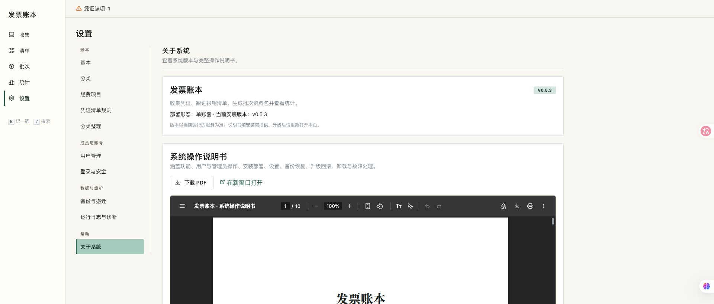

## 21. 图解适用范围与安装部署核对

以上截图覆盖单账套网页的收集入口、清单、详情、列设置、批次、统计和主要设置操作。SaaS 平台控制台、收集识别确认页，以及安装/卸载的系统终端界面因部署方式和原件不同，没有使用合成截图代替实际页面；其逐步文字流程分别见第 3、8、9 至 13、15 至 16 章。安装前以当前仓库 README 和 docs/部署与运维.md 核对命令、端口及版本。执行卸载前逐一确认备份、程序目录和数据目录，不以图示代替实际环境检查。
